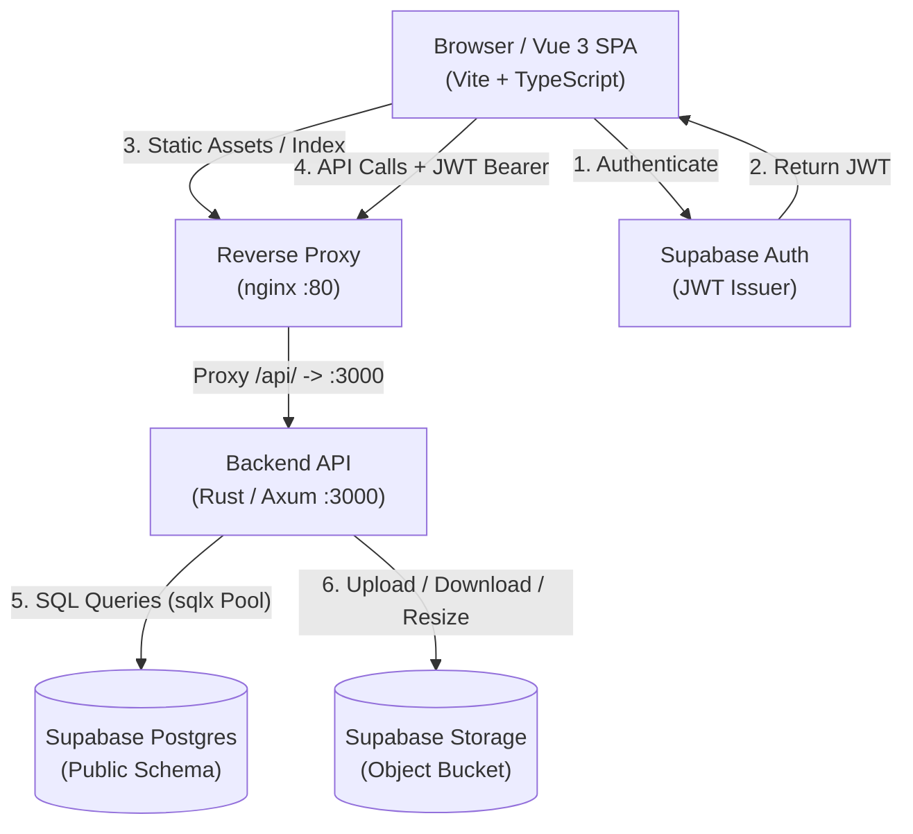
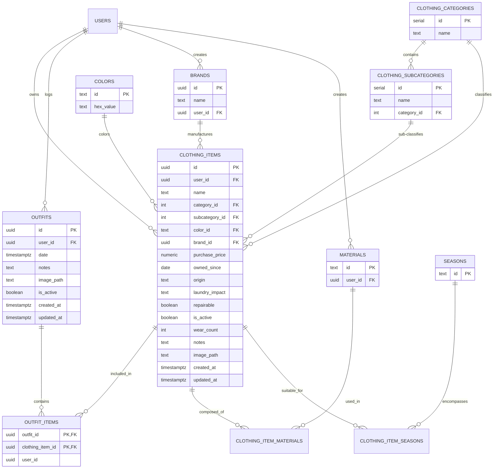
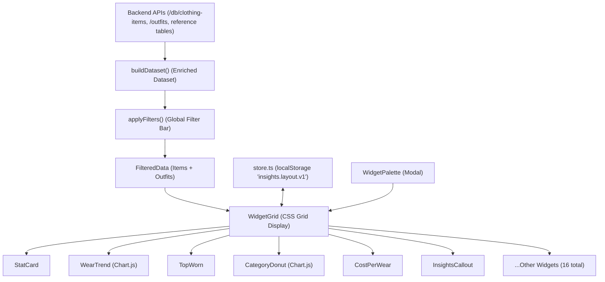

# Cloth Web — Comprehensive & Exhaustive Codebase Specification

> **Version:** 1.0.0  
> **Repository:** `cloth-web`  
> **Target Audience:** Software Architects, Full-Stack Engineers, Security Auditors, and Maintainers  
> **Last Updated:** October 2026

---

## 1. Executive Summary & Repository Identity

### 1.1 Project Purpose and Domain Overview
**Cloth Web** is a full-stack personal wardrobe management, outfit planning, and clothing analytics application. It allows users to catalog individual clothing garments, track their acquisition dates and costs, log outfits worn on specific calendar dates, visualize wardrobe usage patterns, and inspect the underlying database schema.

The application addresses common wardrobe problems:
1. **Underutilized garments**: Identifying items that sit idle ("gathering dust").
2. **Cost per wear (CPW)**: Calculating the true economic value of each garment by dividing purchase price by verified wear count.
3. **Outfit composition and versatility**: Tracking which garments are worn together, identifying wardrobe workhorses, and spotting gaps in seasonal or category coverage.
4. **Care and sustainability**: Tracking laundry environmental impact ratings and garment repairability to foster sustainable wardrobe practices.

### 1.2 Architectural Overview
The architecture is structured around a decoupled, three-tier model:
- **Presentation Layer**: A responsive Single Page Application (SPA) built with **Vue 3**, **TypeScript**, and **Vite**, powered by a custom **Material Design 3 (M3)** design system with zero third-party UI framework dependencies. Charting is delivered via **Chart.js** and **vue-chartjs**, isolated in an asynchronously loaded bundle.
- **Application & API Layer**: A high-performance **Rust** backend built on **Axum** (`0.7`) and **Tokio**, acting as a secure API gateway, generic relational table manager, transactional outfit orchestrator, and media processing engine.
- **Persistence & Cloud Services**: **Supabase**, providing a managed **PostgreSQL 15+** database with Row-Level Security (RLS) and **Supabase Storage** (an S3-compatible object store) for garment and outfit photography.
- **Edge / Reverse Proxy**: **Nginx** acting as a reverse proxy, routing `/api/` traffic to the Axum backend and serving built static assets with client-side routing fallback.



### 1.3 Key Technical Highlights
- **Dual-Layer Defense Sanitization**: Strict input validation occurs both in the browser (for immediate UX feedback) and on the server (authoritative security barrier), covering text lengths, numeric ranges, date limits, filename sanitization, and magic-byte payload inspection.
- **Zero-Dependency UI Kit**: A bespoke Material Design 3 design system implemented entirely with CSS custom properties (design tokens) and native Vue components.
- **Asynchronous Code-Splitting**: The heavyweight analytics suite (Chart.js, charting controllers, SVG math) is split into an independent bundle loaded on demand when the user visits the Insights tab.
- **Timezone Invariant Calendar Engine**: Standardizes dates as plain `YYYY-MM-DD` calendar keys, avoiding timezone shift bugs where UTC conversions displace outfit logging across calendar days.
- **Dynamic Table CRUD Engine**: Generic table endpoints leverage PostgreSQL's `json_populate_record` for type-safe relational inserts and updates without requiring bespoke boilerplate for reference tables.

---

## 2. Repository Contents & Directory Structure

Below is an exhaustive breakdown of the file structure in `cloth-web` (excluding compiler targets and third-party dependencies):

```
cloth-web/
├── .cursorignore                                        # Cursor editor indexing exclusions
├── .env                                                 # Backend environment secrets (DATABASE_URL, JWT secret, etc.)
├── .gitignore                                           # Git exclusion rules (target/, node_modules/, dist/, .env)
├── API_SPECIFICATION.md                                 # Historical CLI API specification document (v0.1.0)
├── Cargo.lock                                           # Locked Rust dependency tree
├── Cargo.toml                                           # Rust backend package manifest and dependencies
├── INSIGHTS_PLAN.md                                     # Planning and architecture document for the Insights tab
├── opencode.json                                        # AI provider configuration (local / Bonsai compatibility)
├── README.md                                            # High-level repository orientation
├── dns_test/                                            # Auxiliary DNS resolution and TCP diagnostic tool
│   ├── Cargo.lock
│   ├── Cargo.toml
│   └── src/main.rs
├── frontend/                                            # Vue 3 + TypeScript SPA frontend
│   ├── .env                                             # Frontend public environment variables (Vite Supabase keys)
│   ├── .gitignore                                       # Frontend build artifacts exclusions
│   ├── index.html                                       # Single Page Application HTML root
│   ├── package-lock.json                                # Locked npm dependency tree
│   ├── package.json                                     # Frontend package manifest, scripts, and dependencies
│   ├── tsconfig.json                                    # TypeScript compiler configuration (strict mode)
│   ├── vite.config.ts                                   # Vite bundler configuration and dev API proxy
│   ├── dist/                                            # Production build output directory
│   ├── src/
│   │   ├── App.vue                                      # Root application shell with nav drawer & KeepAlive tabs
│   │   ├── main.ts                                      # Frontend entrypoint (mounts App to #root)
│   │   ├── vite-env.d.ts                                # Vite client environment typing declarations
│   │   ├── vue-shim.d.ts                                # Vue SFC (*.vue) module declarations
│   │   ├── api/                                         # API communication layer
│   │   │   ├── client.ts                                # Typed fetch client with token refresh & image proxy helpers
│   │   │   └── types.ts                                 # TypeScript models, form states, and domain enums
│   │   ├── components/                                  # High-level application views
│   │   │   ├── ClothesView.vue                          # Wardrobe items grid, search, filters, and item details
│   │   │   ├── ClothingItemForm.vue                     # Reusable creation and edit form for clothing items
│   │   │   ├── InsightsView.vue                         # Insights dashboard tab orchestrator
│   │   │   ├── LoginForm.vue                            # Authentication form (Email/password sign-in & sign-up)
│   │   │   ├── OutfitsView.vue                          # Interactive monthly calendar and outfit logger
│   │   │   ├── TablesView.vue                           # PostgreSQL schema introspection explorer
│   │   │   ├── TableView.vue                            # Single table column list and row preview component
│   │   │   └── insights/                                # Modular analytics components
│   │   │       ├── FilterBar.vue                        # Global dashboard filter toolbar (date range, categories, colors, brands)
│   │   │       ├── FilterSelect.vue                     # Multi-select dropdown pill component for filters
│   │   │       ├── HeatmapGrid.vue                      # 2D grid matrix component for month-by-weekday heatmaps
│   │   │       ├── InsightChart.vue                     # Generic Chart.js wrapper component
│   │   │       ├── insights.smoke.spec.ts               # End-to-end integration smoke tests for insight widgets
│   │   │       ├── MiniBar.vue                          # Inline mini horizontal percentage bar component
│   │   │       ├── period-filter.spec.ts                # Unit tests for per-widget date range filtering
│   │   │       ├── WidgetCard.vue                       # Container wrapper for widgets (drag handle, sizing, config menu)
│   │   │       ├── WidgetGrid.vue                       # Responsive CSS grid with HTML5 drag-and-drop reordering
│   │   │       ├── WidgetPalette.vue                    # Modal drawer for selecting and adding new widgets
│   │   │       └── widgets/                             # Individual analytics widget implementations
│   │   │           ├── BrandBar.vue                     # Brand distribution ranking chart
│   │   │           ├── CategoryDonut.vue                # Category/subcategory breakdown doughnut chart
│   │   │           ├── ColorBar.vue                     # Wardrobe color palette distribution with swatches
│   │   │           ├── CostPerWear.vue                  # Cost-per-wear leaderboard and focus item drilldown
│   │   │           ├── DayOfWeek.vue                    # Outfits per weekday distribution bar chart
│   │   │           ├── DustyItems.vue                   # Longest unworn / dormant inventory table
│   │   │           ├── ExpensiveDusty.vue               # High-value items with low or zero wear count
│   │   │           ├── ImpactHotspots.vue               # High laundry-impact items ranked by wear count
│   │   │           ├── InsightsCallout.vue              # Automated natural-language observation cards
│   │   │           ├── ItemPairings.vue                 # Co-occurrence analysis of garments worn together
│   │   │           ├── LaundryMix.vue                   # Garment distribution by laundry environmental impact
│   │   │           ├── PriceHistogram.vue               # Garment purchase price distribution histogram
│   │   │           ├── RepeatWears.vue                  # Rapid re-wear detection within rolling day windows
│   │   │           ├── SeasonPattern.vue                # Month × weekday calendar heatmap
│   │   │           ├── SpendStats.vue                   # Total, average, and median spend metric cards
│   │   │           ├── StatCard.vue                     # Headline single-number metric card
│   │   │           ├── TopWorn.vue                      # Most worn garments ranking (total wears or wears/month)
│   │   │           ├── WardrobeAge.vue                  # Garment acquisition distribution by year
│   │   │           └── WearTrend.vue                    # Outfits or items worn over time (weekly/monthly)
│   │   ├── lib/                                         # Core business logic and infrastructure helpers
│   │   │   ├── auth.ts                                  # Supabase auth composable (session, user, sign in/out)
│   │   │   ├── dates.spec.ts                            # Unit tests for date formatting and timezone preservation
│   │   │   ├── dates.ts                                 # Timezone-safe calendar date math and key extractors
│   │   │   ├── errors.spec.ts                           # Unit tests for error classification
│   │   │   ├── errors.ts                                # Error classifier with contextual troubleshooting hints
│   │   │   ├── router.spec.ts                           # Unit tests for hash-based router
│   │   │   ├── router.ts                                # Zero-dependency browser hash router with deep linking
│   │   │   ├── sanitize.spec.ts                         # Unit tests for client-side sanitizers and validators
│   │   │   ├── sanitize.ts                              # Client-side input sanitization and image file sniffer
│   │   │   ├── supabase.ts                              # Supabase JS client instantiation
│   │   │   ├── undo.spec.ts                             # Unit tests for the undo manager
│   │   │   ├── undo.ts                                  # In-memory undo manager for reversible user mutations
│   │   │   └── insights/                                # Analytics computation and state management
│   │   │       ├── catalog.ts                           # Definitions, schemas, and defaults for all 16 widgets
│   │   │       ├── charts.ts                            # Chart.js controller registration, theme bindings & palette
│   │   │       ├── format.ts                            # Currency, number, and percentage formatters
│   │   │       ├── metrics.spec.ts                      # Unit tests for statistical and aggregation functions
│   │   │       ├── metrics.ts                           # Pure calculation functions for all metrics and insights
│   │   │       ├── store.spec.ts                        # Unit tests for layout persistence and migration
│   │   │       ├── store.ts                             # LocalStorage layout persistence with version migration
│   │   │       └── types.ts                             # TypeScript types for widgets, filters, and datasets
│   │   └── ui/                                          # Custom Material Design 3 design system
│   │       ├── index.ts                                 # UI module barrel file exporting components and tokens
│   │       ├── types.ts                                 # Design system navigation item interfaces
│   │       ├── components/                              # Base M3 UI components
│   │       │   ├── ErrorDisplay.vue                     # Standardized error alert banner with retry/dismiss
│   │       │   ├── icons.ts                             # Inline SVG icon path map and MdIcon component
│   │       │   ├── ImagePreview.vue                     # Garment image thumbnail preview card with replace trigger
│   │       │   ├── MdAppBar.vue                         # Top application header bar with actions slot
│   │       │   ├── MdButton.vue                         # M3 button supporting filled, tonal, outlined, text, error
│   │       │   ├── MdIconButton.vue                     # Standard circular icon button
│   │       │   ├── MdListItem.vue                       # Navigation list item with icon and active state
│   │       │   ├── MdNavDrawer.vue                      # Collapsible navigation drawer
│   │       │   └── Toast.vue                            # Floating snackbar / toast alert with Undo button
│   │       └── styles/                                  # CSS token definitions
│   │           ├── base.css                             # Typography baseline, box-sizing, and focus rings
│   │           └── tokens.css                           # Full M3 palette (light/dark), elevation, shapes & motion
├── infra/                                               # Infrastructure configuration
│   └── nginx.conf                                       # Production Nginx reverse proxy configuration
├── scripts/                                             # Administrative scripts
│   └── import_export.py                                 # Database backup migration and UUIDv5 generator script
├── src/                                                 # Rust Axum backend source code
│   ├── auth.rs                                          # AuthUser extractor verifying Supabase JWTs
│   ├── db.rs                                            # PostgreSQL connection pool manager (sqlx)
│   ├── http_db/                                         # Experimental/prototype PostgREST client module
│   │   └── mod.rs
│   ├── main.rs                                          # Axum router definition, state binding, and HTTP listener
│   ├── routes.rs                                        # All route handlers: CRUD, outfits, tables, file serving
│   ├── storage.rs                                       # Supabase Storage REST client (upload/download/public URL)
│   ├── test_ipv4.rs                                     # Diagnostic script for IPv4/IPv6 socket resolution
│   └── upload.rs                                        # Image upload sanitization, magic-byte sniffing & key builder
└── supabase/                                            # Supabase database configurations
    └── migrations/                                      # PostgreSQL SQL migrations
        └── 20260922000000_constrain_clothing_item_select_fields.sql # Origin and laundry impact CHECK constraints
```

---

## 3. Database Architecture & Data Models

### 3.1 Entity Relationship Diagram
The following diagram illustrates the relational database model hosted in PostgreSQL:



### 3.2 Data Dictionary

#### 1. `clothing-items` (User-Scoped Table)
Represents individual garments, shoes, or accessories.
- `id` (`uuid`, Primary Key): Generated via UUIDv4 upon insertion.
- `user_id` (`uuid`, Foreign Key): Owner ID matching Supabase `auth.users.id`.
- `name` (`text`, Not Null): Display name (e.g., "Indigo Selvedge Denim").
- `category_id` (`integer`, Nullable, Foreign Key → `clothing-categories.id`): Top-level category.
- `subcategory_id` (`integer`, Nullable, Foreign Key → `clothing-subcategories.id`): Nested subcategory.
- `color_id` (`text`, Nullable, Foreign Key → `colors.id`): Primary color identifier (e.g., "navy", "black").
- `brand_id` (`uuid`, Nullable, Foreign Key → `brands.id`): Manufacturer or label.
- `purchase_price` (`numeric`, Nullable): Financial cost paid for the garment (2 decimal precision).
- `owned_since` (`date`, Nullable): Acquisition date.
- `origin` (`text`, Nullable): Acquisition channel, constrained by SQL CHECK to: `'Bought New'`, `'2nd Hand'`, `'Gift'`, `'Borrowed'`, `'Made Myself'`.
- `laundry_impact` (`text`, Nullable): Washing footprint, constrained by SQL CHECK to: `'Nothing'`, `'Low'`, `'Medium'`, `'High'`.
- `repairable` (`boolean`, Nullable, Default `false`): Whether the item can be tailored or mended.
- `is_active` (`boolean`, Not Null, Default `true`): Soft-deletion / active rotation flag. When `false`, item is hidden from active pickers.
- `wear_count` (`integer`, Nullable, Default `0`): Historical wear counter, automatically incremented and decremented during outfit lifecycle mutations.
- `notes` (`text`, Nullable): Free-form user annotations.
- `image_path` (`text`, Nullable): Supabase storage object key or public URL.
- `created_at` (`timestamptz`, Default `now()`): Creation timestamp.
- `updated_at` (`timestamptz`, Default `now()`): Modification timestamp.

#### 2. `outfits` (User-Scoped Table)
Represents a recorded ensemble worn on a given date.
- `id` (`uuid`, Primary Key): Outfit UUID.
- `user_id` (`uuid`, Foreign Key): Owner ID.
- `date` (`timestamptz`, Not Null): Date when outfit was worn.
- `notes` (`text`, Nullable): Context or occasion notes (e.g., "Summer garden party").
- `image_path` (`text`, Nullable): Optional photo of the styled outfit.
- `is_active` (`boolean`, Not Null, Default `true`): Status flag.
- `created_at` / `updated_at` (`timestamptz`): Timestamps.

#### 3. `outfit-items` (Join Table)
Associates clothing items with outfits.
- `outfit_id` (`uuid`, FK → `outfits.id`, ON DELETE CASCADE).
- `clothing_item_id` (`uuid`, FK → `clothing-items.id`).
- `user_id` (`uuid`, Nullable): Tenant isolation marker.
- Primary Key: Composite `(outfit_id, clothing_item_id)`.

#### 4. Shared Reference Tables
- **`clothing-categories`**: System categories (`id` serial, `name` text).
- **`clothing-subcategories`**: Child categories (`id` serial, `name` text, `category_id` int).
- **`colors`**: Color dictionary (`id` text lowercase e.g., "burgundy", `hex_value` text `#RRGGBB`).
- **`brands`**: Brand list (`id` uuid, `name` text, `user_id` uuid).
- **`seasons`**: Season tags (`id` text: spring, summer, fall, winter, all_season).
- **`materials`**: Fabric definitions (`id` text, `user_id` uuid).

### 3.3 Database Migrations
Migrations are stored in `supabase/migrations/`.
Migration `20260922000000_constrain_clothing_item_select_fields.sql`:
- Cleans and normalizes existing values for `laundry_impact` and `origin`.
- Asserts that no non-conforming rows exist in `clothing-items`.
- Drops previous check constraints if existing.
- Enforces SQL check constraints:
  ```sql
  ALTER TABLE public."clothing-items"
    ADD CONSTRAINT clothing_items_origin_check
      CHECK (origin IS NULL OR origin IN ('Bought New', '2nd Hand', 'Gift', 'Borrowed', 'Made Myself')),
    ADD CONSTRAINT clothing_items_laundry_impact_check
      CHECK (laundry_impact IS NULL OR laundry_impact IN ('Nothing', 'Low', 'Medium', 'High'));
  ```

### 3.4 Data Ingestion & Normalization (`scripts/import_export.py`)
A comprehensive Python script facilitates importing wardrobe backup exports (`cloth_export_*.json`) into Supabase:
- **Deterministic UUID Generation**: The script maps non-UUID legacy string slugs to deterministic UUIDv5s under `uuid.NAMESPACE_URL` with domain prefixes (`cloth-item:<slug>`, `cloth-outfit:<slug>`, `cloth-brand:<name>`). This ensures repeated runs are completely idempotent and foreign key relationships remain stable.
- **Category Aliasing**: Transparently translates legacy free-text categories (e.g., mapping `"base layer"` to `"base-layer"`, `"footwear"` to `"shoes"`) and maps legacy category slugs used as subcategories (e.g., `"t-shirt"` → category `"base-layer"`, subcategory `"t-shirt"`).
- **Multi-Row Batched Inserts**: SQL statements are chunked into 200-row batches with `ON CONFLICT DO NOTHING`.
- **Identity Resynchronization**: Issues `SELECT setval(...)` calls after execution to advance category and subcategory sequence counters past manually inserted IDs.

---

## 4. Backend Implementation Details (Rust / Axum)

### 4.1 Server Architecture (`src/main.rs`)
The Axum web service runs asynchronously on the **Tokio** runtime:
- **Port**: Default binds to `0.0.0.0:3000`.
- **Shared State (`AppState`)**: Wrapped in `Arc<AppState>`, containing:
  - `db`: `sqlx::Pool<sqlx::Postgres>`
  - `storage`: `SupabaseStorage` instance
  - `jwt_secret`: `String` (loaded from `SUPABASE_JWT_SECRET`)
- **Payload Limit**: `DefaultBodyLimit::max(25 * 1024 * 1024)` allows multipart image uploads up to 25 MiB through the outer middleware (further restricted to 10 MiB in the route handler).

```rust
pub struct AppState {
    db: sqlx::Pool<sqlx::Postgres>,
    storage: SupabaseStorage,
    jwt_secret: String,
}
```

### 4.2 Authentication Subsystem (`src/auth.rs`)
Authentication uses Supabase JWTs with `jsonwebtoken`:
- **`AuthUser(pub Uuid)` Extractor**: Implements Axum's `FromRequestParts<Arc<AppState>>`.
- **Extraction Mechanism**:
  1. Inspects the `Authorization` HTTP header for a `Bearer <token>` scheme.
  2. Fallback: Inspects the URI query parameters for `?token=<token>`. This is essential for browser `` elements requesting image files directly through the image proxy endpoint without XMLHttpRequest headers.
- **Cryptographic Validation**:
  - Algorithm: **HS256** using `state.jwt_secret`.
  - Audience: Enforces `aud == ["authenticated"]`.
  - Role check: Explicitly verifies `claims.role == "authenticated"` (rejecting anonymous or `service_role` keys).
  - Subject mapping: Parses the `sub` claim as a standard UUIDv4 representing `user_id`.

```rust
// auth.rs JWT Verification Extract
let mut validation = jsonwebtoken::Validation::new(jsonwebtoken::Algorithm::HS256);
validation.set_audience(&["authenticated"]);

let data = jsonwebtoken::decode::<Claims>(token, &decoding_key, &validation)
    .map_err(|e| (StatusCode::UNAUTHORIZED, e.to_string()))?;

if data.claims.role.as_deref() != Some("authenticated") {
    return Err((StatusCode::UNAUTHORIZED, "invalid token role".to_string()));
}
```

### 4.3 Supabase Storage Client (`src/storage.rs`)
Encapsulates HTTP communication with Supabase Storage via `reqwest::Client`:
- `upload_file(&self, key: &str, bytes: Vec<u8>)`: Issues an authenticated `PUT` request to `{SUPABASE_URL}/storage/v1/object/{BUCKET}/{key}` using the service role key.
- `download_file(&self, path: &str)`: Fetches an object from the bucket, returning `(Vec<u8>, content_type)`.
- `get_public_url(&self, key: &str)`: Returns `{SUPABASE_URL}/storage/v1/object/public/{BUCKET}/{key}`.

### 4.4 Upload Security & Sanitization Engine (`src/upload.rs`)
Client-supplied filenames and payloads are treated as hostile untrusted inputs. Security is enforced through a four-stage barrier:
1. **Size Capping**: Rejects any file larger than `10 * 1024 * 1024` bytes (`MAX_UPLOAD_BYTES`, 10 MiB) with HTTP 413 Payload Too Large.
2. **Path Traversal Neutralization**: `sanitize_filename` uses `.rsplit(['/', '\\'])` to strip directory hierarchy prefixes (`../../etc/passwd` becomes `passwd`).
3. **Filename & Extension Allowlist**:
   - Allowed extensions: `["jpg", "jpeg", "png", "webp", "gif"]`. All others are rejected.
   - Allowed characters: `[a-zA-Z0-9-_]`. Any character outside this set is replaced with `_`.
   - Length capped at 100 characters (`MAX_NAME_LEN`).
4. **Magic-Byte Sniffing**: Inspects the leading binary payload to verify that image signatures match claimed extensions:
   - JPEG: `[0xFF, 0xD8, 0xFF, ..]`
   - PNG: `[0x89, 0x50, 0x4E, 0x47, ..]`
   - GIF: `[0x47, 0x49, 0x46, 0x38, ..]`
   - WEBP: `b"RIFF" + 4 bytes + b"WEBP"`
   Renamed scripts (e.g. `exploit.php.png`) containing non-image bytes are rejected with `415 Unsupported Media Type`.
5. **Per-User Collision-Free Storage Keys**:
   Keys follow the format:
   ```
   users/{user_id}/{uuid_v4}-{sanitized_name}.{ext}
   ```
   This pattern guarantees that uploads can never overwrite another user's files, nor collide with the user's own existing files.

### 4.5 Route Handlers & Business Logic (`src/routes.rs`)

#### 1. Schema Introspection (`GET /tables`)
Queries `information_schema.tables` and `information_schema.columns` where `table_schema = 'public'`, returning column metadata (table name, column name, and data type).

#### 2. Dynamic Generic Relational CRUD
- **`GET /db/:table`**: Validates table existence in `public`. Checks for the presence of a `user_id` column. If present, executes:
  ```sql
  SELECT to_jsonb(t) AS row FROM public."{table}" t WHERE t.user_id = $1 ORDER BY 1 LIMIT 500
  ```
  If absent (shared reference tables), reads without user filtering:
  ```sql
  SELECT to_jsonb(t) AS row FROM public."{table}" t ORDER BY 1 LIMIT 500
  ```
- **`POST /db/:table`**:
  - Restricts insertions strictly to user-scoped tables (shared reference tables return `403 Forbidden`).
  - Validates any supplied `image_path` using `validate_image_path` to guarantee it points to `users/{user_id}/...`.
  - Injects `user_id` and generates a UUIDv4 `id` if omitted.
  - Dynamically builds a CTE utilizing PostgreSQL's `json_populate_record`:
    ```sql
    WITH r AS (
      SELECT * FROM json_populate_record(NULL::public."{table}", $1::json)
    ),
    inserted AS (
      INSERT INTO public."{table}"
      SELECT COALESCE(r."created_at", now()), ... FROM r
      RETURNING *
    )
    SELECT to_jsonb(inserted.*) AS row FROM inserted
    ```
- **`PATCH /db/:table/:id`**:
  - Validates `image_path` ownership.
  - Dynamically builds an `UPDATE` statement mapping provided JSON keys (ignoring `id` and `user_id`).
  - Automatically appends `"updated_at" = now()` if the table has an `updated_at` column.
- **`DELETE /db/:table/:id`**:
  - Explicitly blocks deleting from the `"outfits"` table (returns `405 Method Not Allowed`, directing callers to `DELETE /outfits/:id`).
  - Scopes deletion strictly to `WHERE id::text = $1 AND user_id = $2`.

#### 3. Transactional Outfits Management
- **`GET /outfits`**:
  Executes an aggregated join query that embeds the full JSON array of clothing items for every outfit:
  ```sql
  SELECT to_jsonb(o) || jsonb_build_object(
    'date', to_char(o.date, 'YYYY-MM-DD'),
    'items', COALESCE((
      SELECT jsonb_agg(to_jsonb(ci) ORDER BY ci.name)
      FROM "outfit-items" oi
      JOIN "clothing-items" ci ON ci.id = oi.clothing_item_id
      WHERE oi.outfit_id = o.id
    ), '[]'::jsonb)) AS row
  FROM outfits o
  WHERE o.user_id = $1 ORDER BY o.date
  ```
- **`POST /outfits`**:
  Runs inside an explicit PostgreSQL transaction (`tx.begin().await`):
  1. Inserts into `outfits (user_id, date, notes, is_active, created_at, updated_at)`.
  2. Iterates over `item_ids`, inserting into `"outfit-items" (outfit_id, clothing_item_id)`.
  3. Increments wear counts on all referenced items:
     ```sql
     UPDATE "clothing-items" ci
     SET wear_count = COALESCE(ci.wear_count, 0) + 1, updated_at = now()
     FROM (SELECT DISTINCT clothing_item_id FROM "outfit-items" WHERE outfit_id = $1) s
     WHERE ci.id = s.clothing_item_id AND ci.user_id = $2
     ```
  4. Commits transaction and returns the populated outfit.
- **`DELETE /outfits/:id`**:
  Runs inside an explicit database transaction:
  1. Decrements wear counts for associated clothing items, bounded at 0:
     ```sql
     UPDATE "clothing-items" ci
     SET wear_count = GREATEST(COALESCE(ci.wear_count, 0) - 1, 0), updated_at = now()
     FROM (SELECT DISTINCT clothing_item_id FROM "outfit-items" WHERE outfit_id = $1) s
     WHERE ci.id = s.clothing_item_id AND ci.user_id = $2
     ```
  2. Removes joins from `"outfit-items"`.
  3. Deletes outfit from `outfits`.
  4. Commits transaction.

#### 4. Image Upload & On-the-Fly Resizing Pipeline
- **Upload Flow (`POST /upload`)**:
  - Reads multipart form data.
  - Sanitizes filename and verifies magic bytes.
  - **Auto-Orientation**: Detects EXIF orientation tags (`kamadak-exif`) and applies lossless pixel transformations (rotations/flips).
  - **Downscaling**: If max dimension exceeds 1600px (`MAX_IMAGE_DIMENSION`), resizes using a high-quality `Lanczos3` filter.
  - **Re-encoding**: Opaque images are re-encoded to progressive JPEG at quality 80. Images with an alpha channel (transparency) are left untouched to prevent corruption.
  - Stores processed bytes in Supabase Storage and returns the public URL.
- **Dynamic Image Serving & Resizing Proxy (`GET /files/*path`)**:
  - Enforces tenant isolation: `object_path_within_user` checks that the requested path starts with `users/{user_id}/` and contains no `..` or `\`. Foreign requests receive `404 Not Found`.
  - Supports dynamic resizing via `?width=<width>` query parameter (capped at 4096px to mitigate memory exhaustion attacks).
  - Downscales using Lanczos3, encodes as JPEG quality 80, and streams with appropriate `Content-Type` headers.

---

## 5. Frontend Implementation Details (Vue 3 + TypeScript)

### 5.1 Build Configuration & Code Splitting (`vite.config.ts`)
- Configured with `@vitejs/plugin-vue`.
- In development, proxies `/api/*` requests to the local backend `http://localhost:3000/`.
- `App.vue` uses `defineAsyncComponent(() => import('./components/InsightsView.vue'))` to split the analytics tab (and the Chart.js library) into a distinct chunk, keeping the initial bundle size small and load times fast.

### 5.2 Application Shell & Tab Lifecycle (`App.vue`)
- Mounts `#app` with an `MdAppBar` and `MdNavDrawer`.
- Nav items: `clothes` (Clothes), `outfits` (Outfits), `insights` (Insights), `tables` (Tables).
- Uses Vue's `<KeepAlive>` component wrapping `<component>` views. Tab switching preserves component state, form drafts, active search filters, and scroll positions without re-fetching data.

### 5.3 Client-Side Routing & Deep Linking (`frontend/src/lib/router.ts`)
Cloth Web implements a lightweight, zero-dependency browser hash router (`useRouter()`):
- **Hash Structure**: `#<tab>?<query_params>` (e.g. `#clothes?item=c7b74f36-397a-4284-9844-32b0051ef40d`).
- **History Integration**: Uses `window.history.pushState` and `window.history.replaceState`.
- **Navigation Invariants**: Listens to `hashchange` and `popstate` events to synchronize `currentRoute` state.
- **Deep Linking**: The `clothes` tab watches `router.params.value.item` to immediately open the specified item's detail view when deep-linked or navigated via browser back/forward buttons.

### 5.4 Timezone-Invariant Date Utilities (`frontend/src/lib/dates.ts`)
A critical engineering challenge in wardrobe logging is timezone drift. Standard JavaScript `new Date("2026-09-22").toISOString()` converts midnight local time to UTC, shifting the date to the previous day in western timezones (e.g. UTC-5 New York) or next day in eastern timezones.
`dates.ts` guarantees date integrity across all timezones:
- `parseOutfitDateKey(dateStr)`: Uses regex extraction (`^(\d{4})-(\d{2})-(\d{2})`) to preserve the calendar date string directly without timezone conversion.
- `formatLocalDateKey(d)`: Formats Date objects using local calendar date parts (`getFullYear()`, `getMonth()`, `getDate()`).
- `formatSelectedDateLabel(dateKey)`: Constructs dates using integer parts `new Date(year, month - 1, day)` for localized long date labels.

### 5.5 Error Handling Architecture (`frontend/src/lib/errors.ts`)
Centralized error handling engine (`classifyError`):
- Classifies raw exceptions into typed categories:
  - `network`: Fetch failures, connection timeouts, status 500s. Displays retry prompts.
  - `validation`: Field constraint failures or bad payloads. Displays specific validation issues.
  - `auth`: 401 Unauthorized or expired JWTs. Instructs user to re-authenticate.
  - `unknown`: Fallback for unexpected runtime issues.
- `ErrorDisplay.vue`: Renders accessible alert banners with optional retry actions and dismissal.

### 5.6 Reversible Mutation Engine (`frontend/src/lib/undo.ts`)
Provides user safeguards for destructive actions:
- `UndoManager`: In-memory stack holding the last 5 user mutations (`type`, `itemId`, `name`, `undo` closure).
- Used during clothing item deletions: Deleting an item triggers a `Toast.vue` with an "Undo" button. Clicking undo restores the item immediately without leaving the screen.

### 5.7 Client-Side Input Sanitization (`frontend/src/lib/sanitize.ts`)
Mirrors the backend sanitization rules in TypeScript to provide instant form validation:
- **`sanitizeText(val, { max, keepNewlines })`**: Strips control characters (preserving newlines in notes), trims whitespace, and caps length.
- **`sanitizeInt` & `sanitizeDecimal`**: Coerces inputs to numbers, enforces min/max boundaries, and rounds to decimal precision (e.g. 2 decimal places for price).
- **`isValidHexColor`**: Validates `#RRGGBB` format via `/^#[0-9a-fA-F]{6}$/`.
- **`isValidDate`**: Ensures valid calendar dates between `1900-01-01` and current day.
- **`validateImageFile(file)`**: Client-side image validation:
  1. Checks MIME type against `['image/jpeg', 'image/png', 'image/webp', 'image/gif']`.
  2. Validates file extension.
  3. Enforces 10 MiB size ceiling.
  4. Inspects leading 16 bytes for magic-byte signatures via `Uint8Array`.
  5. Decodes dimensions via `createImageBitmap` or `Image()`, rejecting corrupt files or images wider/taller than 8000px.

---

## 6. Custom Material Design 3 Design System (`frontend/src/ui/`)

Cloth Web features an in-house design system created according to Material Design 3 (Material You) guidelines.

### 6.1 Design Tokens (`frontend/src/ui/styles/tokens.css`)
- **Color Roles**: Full M3 tonal palette:
  - Primary (`#6750a4`), On-Primary (`#ffffff`), Primary Container (`#eaddff`), On-Primary Container (`#21005d`)
  - Secondary (`#625b71`), Tertiary (`#7c5872`), Error (`#b3261e`)
  - Surface containers: `surface-dim`, `surface-bright`, `surface-container-lowest` through `surface-container-highest`
  - Outline & Outline-Variant (`#79747e`, `#cac4d0`)
- **Typography Scale**: Display, Headline, Title, Body, and Label scales with font-size, line-height, and font-weight CSS custom properties.
- **Elevation System**: CSS box-shadow levels from `elevation-0` to `elevation-5`.
- **Shapes & Motion**: Corner radiuses from `extra-small` (4px) to `full` (9999px), and animation durations (`extra-short: 100ms`, `short: 250ms`).

### 6.2 Component Catalog
- **`MdAppBar.vue`**: Fixed top application header with navigation hamburger button, title, and flexible actions slot.
- **`MdNavDrawer.vue`**: Navigation drawer supporting active tab highlighting, icon rendering, and responsive auto-collapse on screens under 768px.
- **`MdButton.vue`**: Button component supporting five variants (`filled`, `tonal`, `outlined`, `text`, `error`), disabled states, and focus-visible styling.
- **`MdIconButton.vue`**: Minimalist icon action button.
- **`MdListItem.vue`**: List row supporting leading icons, active states, and custom action slots.
- **`ErrorDisplay.vue`**: Alert container with alert icons, contextual messages, retry buttons, and dismissal.
- **`Toast.vue`**: Floating snackbar anchored to the bottom-right of the viewport with action slot for reversible mutations.
- **`ImagePreview.vue`**: Image thumbnail preview with replacement triggers and error fallback handling.
- **`icons.ts`**: Pure SVG icon library providing 24px scalable vectors without external font dependencies.

---

## 7. Application Views & User Workflows

### 7.1 Clothes Management View (`ClothesView.vue` & `ClothingItemForm.vue`)
- **Listing & Search**:
  - Live search filtering across garment names, brand names, and notes.
  - Category pill filter allowing instantaneous switching between all items and specific categories.
  - Garment cards displaying photo thumbnail (served via resizing proxy at 480px width), category tags, subcategory tags, brand names, and real color swatches.
- **Item Details Modal**:
  - Full-resolution photo preview (720px width).
  - Definition list of all garment attributes: Category, Subcategory, Color, Brand, Purchase Price, Owned Since, Origin, Laundry Impact, Repairable, Wear Count, and Active Status.
  - Creation and update timestamps.
- **Destructive Action Protection**:
  - Deletion triggers an in-place confirmation panel explaining that deletion permanently removes the garment from wardrobe history and all past outfits.
  - Offers a non-destructive alternative: **"Deactivate instead"**, marking the garment as inactive so it remains in historical outfits without appearing in daily pickers.
  - Permenant deletion triggers an undo toast via `UndoManager`.
- **Garment Form (`ClothingItemForm.vue`)**:
  - Real-time client-side image validation.
  - Inline entity creation: Dropdowns for Category, Subcategory, Color, and Brand feature a **"+ Add new..."** option that expands inline input fields without navigating away from the form.
  - Searchable brand dropdown with keyboard navigation and filtering.

### 7.2 Outfits & Calendar View (`OutfitsView.vue`)
- **Interactive Calendar**:
  - Monthly calendar grid with day cells indicating the current day and selected date.
  - Previous/next month navigation buttons and "Today" shortcut.
  - Cells display up to 3 outfit chips showing item thumbnails (`firstItemImage` rendered at 28px) and labels, with overflow badges (`+N more`).
- **Outfit Logging Sidebar**:
  - Selecting any calendar day reveals logged outfits for that day and an "Add outfit" form.
  - Outfit cards display the list of included garments, occasion notes, and a deletion trigger.
  - Deleting an outfit prompts for confirmation and automatically decrements the wear counts of all associated clothing items in the database.
- **Garment Picker**:
  - Multi-select checkbox list with search bar and category filter dropdown.
  - Displays selected items as dismissible chips.
  - Clear visual indicators for inactive items.

### 7.3 Schema Explorer (`TablesView.vue` & `TableView.vue`)
- Admin / developer tool providing live visibility into the PostgreSQL database.
- Groups columns by table name and lists SQL data types (`uuid`, `text`, `integer`, `boolean`, `timestamp with time zone`, `numeric`).
- Renders an interactive table preview displaying the first 5 rows of each table.

---

## 8. Analytics & Insights Subsystem

The **Insights** tab is an advanced, modular wardrobe intelligence dashboard.



### 8.1 Data Layer & In-Memory Enrichment (`InsightsView.vue`)
On mounting, the Insights tab fetches all user garments, logged outfits, colors, categories, subcategories, and brands in parallel via `Promise.all`.
The `buildDataset()` routine creates an in-memory denormalized graph:
- Resolves foreign keys to human-readable names (`category_name`, `subcategory_name`, `brand_name`).
- Attaches color hex values (`color_hex`) to garments.
- Parses outfit timestamps to timezone-safe calendar date keys (`dateKey`).

### 8.2 Global Filtering Pipeline (`lib/insights/metrics.ts`)
The `FilterBar.vue` component provides multi-dimensional filtering across:
- **Date Presets**: All time, Last 30 days, Last 90 days, Last year, or Custom date ranges (`from` / `to`).
- **Categories**: Multi-select category filter.
- **Colors**: Multi-select color palette filter.
- **Brands**: Multi-select brand filter.
- **Active Only**: Toggle to exclude inactive/archived garments.
Filters apply reactively via `applyFilters()`, filtering both the master garment array and nested garment references within outfits. Outfits with no surviving garments are pruned.

### 8.3 Widget Grid & Persistence Architecture (`lib/insights/store.ts`)
- **Grid Layout**: Responsive CSS Grid supporting sizes `sm` (1 column), `md` (2 columns), and `lg` (3 columns).
- **Drag-and-Drop Reordering**: Built with native HTML5 drag events (`dragstart`, `dragover`, `drop`).
- **Configuration Schema**: Each widget defines a declarative `configSchema` supporting select dropdowns, numbers, toggles, item selectors, and per-widget date range overrides.
- **State Persistence**: Serialized to browser `localStorage` under `insights.layout.v1`. Validates stored layouts against the current catalog, dropping obsolete widgets and filling missing configuration defaults. Includes a "Reset to defaults" feature.

### 8.4 Exhaustive Catalog of Widgets (`lib/insights/catalog.ts`)

| # | Widget Type | Category | Default Size | Description & Mathematical Implementation |
|---|-------------|----------|--------------|--------------------------------------------|
| 1 | `stat-card` | Usage | `sm` | Computes a headline metric: Total Items, Active Items, Outfits Logged, Total Wears, Never Worn items, Dusty items, Total Spend, Average Price, Average Cost Per Wear, Items Per Outfit, or Current Outfit Logging Streak (consecutive days ending today/yesterday). |
| 2 | `wear-trend` | Usage | `lg` | Time-series visualization using Chart.js line or bar charts. Groups logged outfits or items worn by week (Monday-based buckets) or month. |
| 3 | `top-worn` | Usage | `md` | Ranks most frequently worn items from outfit logs or the wear count field. Supports ranking by total wears or normalized wears-per-month (dividing wear count by months owned). |
| 4 | `dusty-items` | Usage | `md` | Identifies garments that have not been worn within a configurable threshold (default: 30 days). Sorted by days unworn, original purchase price, or acquisition date. |
| 5 | `day-of-week` | Usage | `sm` | Computes the distribution of outfit logs across weekdays (Monday through Sunday) to highlight routine patterns. |
| 6 | `season-pattern`| Usage | `md` | 2D heatmap matrix (`HeatmapGrid.vue`) mapping month of the year against day of the week, with color intensity proportional to logging activity. |
| 7 | `category-donut`| Wardrobe | `sm` | Doughnut chart showing wardrobe breakdown by category or subcategory, weighted by item count or monetary spend. |
| 8 | `color-bar` | Wardrobe | `md` | Bar distribution of wardrobe colors rendering authentic `#RRGGBB` color swatches alongside counts or spend. |
| 9 | `brand-bar` | Wardrobe | `md` | Ranked bar chart of manufacturers/labels, displaying item count, total spend, or average garment price per brand. |
| 10| `price-histogram`| Wardrobe | `md` | Buckets wardrobe items into configurable price tiers (4 to 12 bins) to reveal garment spending distribution. |
| 11| `wardrobe-age` | Wardrobe | `md` | Bar chart tracking garment acquisition by year based on `owned_since` or `created_at`. |
| 12| `spend-stats` | Value | `sm` | Aggregate financial metrics: Total Wardrobe Spend, Mean Garment Price, and Median Garment Price. Can be scoped to all time or specific acquisition years. |
| 13| `cost-per-wear`| Value | `md` | Calculates CPW ($\text{Price} / \max(\text{Wears}, 1)$). Ranks best-value workhorses vs worst-value investments. Features a focus item selector and wardrobe average CPW comparison line. |
| 14| `expensive-dusty`| Value | `md` | Filters garments exceeding a price threshold (default: $50) with zero or few wears ($\le 0$), exposing costly closet idling. |
| 15| `laundry-mix` | Sustainability | `sm` | Visualizes the distribution of wardrobe items across laundry impact categories (`Low`, `Medium`, `High`, `Nothing`). |
| 16| `impact-hotspots`| Sustainability | `md` | Flags high environmental impact items ranked by wear count, identifying garments that drive the highest washing footprint. |
| 17| `item-pairings` | Relationships | `md` | Combinatorial co-occurrence algorithm analyzing which garments are worn together in outfits most frequently. Supports filtering by a focus garment. |
| 18| `repeat-wears` | Relationships | `md` | Detects rapid re-wears by analyzing whether a garment was worn again within a short rolling window (e.g., 7 days). |
| 19| `insights-callout`| Insights | `md` | Natural-language insight generator. Automatically emits observations including: Pareto 80/20 wardrobe usage share (e.g. "Top 20% of items account for 68% of wears"), never-worn warnings, top garment callouts, and laundry impact alerts. |

---

## 9. Security & Hardening Architecture

Cloth Web incorporates defensive measures across all layers of the stack:

### 9.1 Authentication & Multi-Tenancy Isolation
- **Role Verification**: The backend strictly checks `claims.role == "authenticated"`, preventing anonymous callers or mismatched tokens from accessing the API.
- **Tenant Enforcement in SQL**: Every query touching user data enforces `WHERE user_id = $1`. The generic table API automatically injects the authenticated `user_id` into all insert and update payloads, preventing users from creating or modifying records under other user IDs.
- **Reference Table Protection**: Reference tables without a `user_id` column cannot be written to via the generic `/db/:table` endpoint; mutations return `403 Forbidden`.

### 9.2 File Storage & Asset Security
- **Directory Traversal Prevention**: Path components (`/` and `\`) and traversal tokens (`..`) are stripped from upload filenames and asset proxy requests.
- **Object Path Authorization**: When serving files via `/files/*path` or writing `image_path` references to the database, the backend verifies that the path matches `users/{authenticated_user_id}/...`. A user cannot reference or download another user's stored photos.
- **MIME & Magic-Byte Sniffing**: Both frontend and backend verify magic bytes, ensuring that executable scripts or malicious HTML files cannot masquerade as images.
- **Image Bomb & DoS Mitigation**:
  - Upload sizes are capped at 10 MiB.
  - Image decode dimensions are guarded against decompression bombs (max 1600px storage resize on the server; max 8000px on the client).
  - Dynamic image proxy resize requests are capped at 4096px (`MAX_SERVE_WIDTH`).

### 9.3 Client-Side Sanitization & XSS Prevention
- All user text is sanitized by stripping ASCII control characters (`[\u0000-\u001F\u007F]`).
- Vue 3 templates automatically escape interpolated strings, preventing XSS injection.
- Database writes are executed via SQLx parameterized queries, neutralizing SQL injection.

---

## 10. Testing & Quality Assurance

The repository maintains an automated test suite across both backend and frontend.

### 10.1 Backend Unit Tests (`src/upload.rs`, `src/routes.rs`)
Executed via `cargo test`.
16 unit tests covering:
- Filename sanitization, directory traversal stripping (`../../etc/passwd` → `passwd`), and character escaping.
- Extension allowlist verification and case-insensitivity (`PHOTO.JPG` → `PHOTO.jpg`).
- Magic-byte sniffing for JPEG, PNG, GIF, and WEBP signatures.
- Per-user storage key generation uniqueness.
- Storage path ownership and authorization (`object_path_within_user` accepting own files, rejecting foreign users, and rejecting traversal).
- Stored image path URL parsing (`extract_object_path`).
- Image path database write validation (`validate_image_path`).

### 10.2 Frontend Unit & Integration Tests (Vitest)
Executed via `npm test` in `frontend/`:
165 automated tests across 9 test suites:
1. `src/components/insights/insights.smoke.spec.ts`: End-to-end integration smoke testing of all 16 widgets, testing rendering, configuration changes, and empty states.
2. `src/components/insights/period-filter.spec.ts`: Tests date range filtering across presets and custom boundaries.
3. `src/lib/dates.spec.ts`: Verifies calendar date key parsing and timezone invariance across offsets.
4. `src/lib/errors.spec.ts`: Tests error classification rules and suggestion generation.
5. `src/lib/router.spec.ts`: Tests hash parsing, route navigation, and deep-linking query string serialization.
6. `src/lib/sanitize.spec.ts`: Tests text sanitizers, integer/decimal coercers, date validators, hex color validators, and magic-byte sniffers.
7. `src/lib/undo.spec.ts`: Tests the undo stack, capacity capping, and execution order.
8. `src/lib/insights/metrics.spec.ts`: Tests every statistical function (cost-per-wear, streaks, Pareto distributions, groupings, heatmaps, pairings, and re-wears).
9. `src/lib/insights/store.spec.ts`: Tests layout serialization, deserialization, catalog validation, and version migration.

---

## 11. Infrastructure, Configuration & Deployment

### 11.1 Environment Variables Reference

#### Backend Environment (`.env`)
| Variable | Description |
|---|---|
| `DATABASE_URL` | PostgreSQL connection string (Supabase transaction pooler or direct connection) |
| `SUPABASE_URL` | Base URL of the Supabase project instance (e.g. `https://xyz.supabase.co`) |
| `SUPABASE_JWT_SECRET` | Secret key used to verify HS256 signatures on user JWT tokens |
| `SUPABASE_SERVICE_ROLE_KEY` | High-privilege service-role key used for server-to-server Supabase Storage uploads |
| `SUPABASE_STORAGE_BUCKET` | Target Supabase Storage bucket name for photos (e.g. `clothing-wardrobe`) |
| `PORT` | Optional port override for the Axum server (defaults to `3000`) |

#### Frontend Environment (`frontend/.env`)
| Variable | Description |
|---|---|
| `VITE_SUPABASE_URL` | Public project URL for Supabase client authentication |
| `VITE_SUPABASE_PUBLISHABLE_KEY`| Public anon API key for Supabase client authentication |
| `VITE_SUPABASE_BUCKET` | Bucket name referenced in frontend storage URLs |

### 11.2 Nginx Deployment Configuration (`infra/nginx.conf`)
In production, Nginx serves the compiled frontend assets and proxies API calls to Axum:
```nginx
server {
  listen 80;
  server_name example.com;

  root /var/www/cloth-web/frontend/dist;
  index index.html;

  location /api/ {
    proxy_pass http://127.0.0.1:3000/;
    proxy_http_version 1.1;
    proxy_set_header Host $host;
    proxy_set_header X-Real-IP $remote_addr;
    proxy_set_header X-Forwarded-For $proxy_add_x_forwarded_for;
    proxy_set_header X-Forwarded-Proto $scheme;
  }

  location / {
    try_files $uri /index.html;
  }
}
```

### 11.3 Build and Execution Commands
- **Backend Development**: `cargo run` (starts Axum on `http://localhost:3000`).
- **Backend Testing**: `cargo test`.
- **Frontend Development**: `npm run dev` in `frontend/` (starts Vite on `http://localhost:5173`).
- **Frontend Testing**: `npm test` in `frontend/` (executes Vitest).
- **Frontend Typecheck**: `npm run typecheck` in `frontend/` (`tsc --noEmit`).
- **Frontend Production Build**: `npm run build` in `frontend/` (outputs to `frontend/dist/`).

